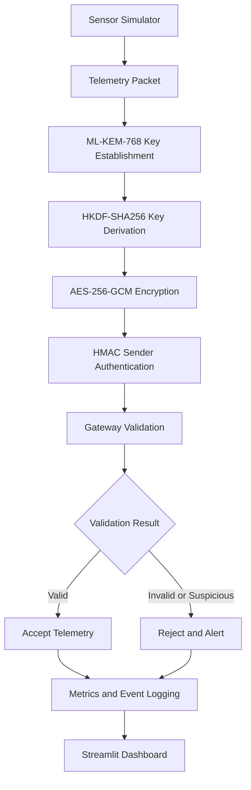

 <div align="center">

# Q Guards

**Expo_growth** · Team ID: **VTU-QFF-HC-0192** · Tier: **Online**

*VTU-QFF Hackathon — VTU Qiskit Fall Fest 2026*

</div>

---

<div align="center">

| | |
| :--- | :--- |
| **Team** | Expo_growth |
| **Team ID** | VTU-QFF-HC-0192 |
| **Tier** | Online |
| **Repository** | [vtu-hc-expo-growth](https://github.com/vtu-qiskit-fall-fest-2026/vtu-hc-expo-growth) |
| **Organisation** | [vtu-qiskit-fall-fest-2026](https://github.com/vtu-qiskit-fall-fest-2026) |
| **Event** | VTU-QFF Hackathon — VTU Qiskit Fall Fest 2026 |
| **Project** | Q Guards — Secure IoT Telemetry Prototype |

</div>

---

## 📌 Table of Contents

- [Team Members](#-team-members-github-ids)
- [Problem Statement](#-problem-statement)
- [Proposed Solution](#-proposed-solution)
- [Approach and Architecture](#-approach--architecture)
- [Tech Stack](#-tech-stack)
- [Project Structure](#-project-structure)
- [How to Run](#-how-to-run)
- [Security Demonstrations](#-security-demonstrations)
- [Testing and Results](#-testing-and-results)
- [Limitations](#-limitations)
- [How to Push Code](#-how-to-push-code)
- [Submission Checklist](#-submission-checklist)
- [Resources](#-resources)
- [License](#-license)

---

## 👥 Team Members (GitHub IDs)

| # | Name | GitHub Username / Profile | Role |
| :-- | :--- | :--- | :--- |
| 1 | Omkar Kalmesh Hadapad | [omkar_hadapad](https://github.com/Omkar-hadapad) | Team Lead |
| 2 | Annappa C | [annappa7746-crypto](https://github.com/annappa7746-crypto) | Developer |

Verify member details and collaborator permissions against the official team registration before submission.

---

## ❓ Problem Statement

**Problem:** IoT monitoring systems exchange telemetry that can be exposed to interception, modification, unauthorized senders, and replay attacks. A monitoring gateway needs to validate incoming sensor messages and identify suspicious traffic.

**Why it matters:** Invalid or replayed sensor readings can mislead monitoring and decision-making. This prototype demonstrates layered cryptographic protection and gateway-side detection of selected attack scenarios.

**Track / Category:** Online — VTU-QFF Hackathon, VTU Qiskit Fall Fest 2026.

*This is the project's problem framing, not a quotation of the organizer's official problem statement. Add an official challenge link here if required by the organizer.*

---

## 💡 Proposed Solution

**Solution:** Q Guards is a Python prototype that simulates sensor telemetry, establishes a shared secret using ML-KEM-768, derives an encryption key, and protects telemetry with AES-256-GCM. The gateway validates messages, checks sender authentication and replay conditions, records security events, and exposes monitoring information through a Streamlit dashboard.

A separate BB84 experiment uses Qiskit simulation to illustrate how an intercept-resend eavesdropper can affect the quantum bit error rate (QBER).

**Key idea:** Combine post-quantum key establishment, authenticated encryption, sender authentication, replay protection, and observable security events in one demonstrable telemetry workflow.

**Why this approach:** Each mechanism has a distinct role. ML-KEM establishes a shared secret; AES-GCM protects message contents; HMAC authenticates messages using a separately provisioned key; replay checks reject repeated or out-of-order messages.

---

## 🧩 Approach and Architecture



### Processing stages

1. **Input:** Generate simulated sensor readings and telemetry metadata.
2. **Key establishment:** Use ML-KEM-768 to establish a shared secret between sender and gateway.
3. **Key derivation:** Use HKDF-SHA256 to derive a 256-bit AES key from the shared secret.
4. **Protection:** Encrypt telemetry with AES-256-GCM and use HMAC for sender-message authentication with a separate key.
5. **Gateway validation:** Check message format, authentication, and replay conditions; reject invalid or suspicious messages.
6. **Monitoring:** Record events and counters for accepted and rejected messages.
7. **Quantum experiment:** Separately simulate BB84 and compare QBER under configured conditions.

### Cryptographic distinction

- **Post-quantum cryptography (PQC):** ML-KEM-768 is a standardized key-encapsulation mechanism intended to resist attacks from quantum-capable adversaries.
- **Quantum key distribution (QKD):** BB84 is an educational simulation of a quantum communication protocol. This project does not perform physical quantum communication.

ML-KEM does not authenticate a peer's identity by itself. The gateway public key must be trusted, and the separate HMAC key must be provisioned securely.

---

## 🛠️ Tech Stack

| Layer | Technology |
| :--- | :--- |
| Language | Python |
| Cryptography | `cryptography` library |
| Post-quantum key establishment | ML-KEM-768 |
| Key derivation | HKDF-SHA256 |
| Authenticated encryption | AES-256-GCM |
| Sender authentication | HMAC |
| Quantum simulation | Qiskit and Qiskit Aer |
| Dashboard | Streamlit |
| Configuration | PyYAML |
| Testing | pytest |
| Environment | Python virtual environment |
| Version control | Git and GitHub |

---

## 📁 Project Structure

```text
Q-Guards-submit/
├── README.md
├── requirements.txt
├── pyproject.toml
├── LICENSE
├── config/
│   └── settings.yaml
├── dashboard/
│   └── app.py
├── docs/
│   ├── architecture.md
│   ├── limitations.md
│   ├── problem_statement.md
│   ├── requirements_matrix.md
│   ├── research_comparison.md
│   ├── test_plan.md
│   └── threat_model.md
├── presentation/
│   ├── demo_script.md
│   └── slides_outline.md
├── scripts/
│   ├── benchmark.py
│   ├── run_demo.py
│   ├── run_tests.py
│   └── self_check.py
├── src/
│   └── qguards/
│       ├── main.py
│       ├── gateway/
│       ├── monitoring/
│       ├── quantum/
│       ├── security/
│       └── telemetry/
├── tests/
│   ├── integration/
│   ├── security/
│   └── unit/
├── bb84_protocol.py
├── qber_detector.py
└── experiment_runner.py
```

Additional root-level experiment files and tests may be included as the repository is consolidated. Consult the current checkout for the exact file list.

---

## 🚀 How to Run

### Prerequisites

- Python compatible with the versions specified in `pyproject.toml` and `requirements.txt`
- Git
- A terminal and a virtual environment
- No quantum hardware is required for the simulated BB84 experiment

### 1. Clone the repository

```bash
git clone https://github.com/vtu-qiskit-fall-fest-2026/vtu-hc-expo-growth.git
cd vtu-hc-expo-growth
```

### 2. Create and activate a virtual environment

**Windows Command Prompt:**

```cmd
python -m venv .venv
.venv\Scripts\activate
```

**Linux / macOS:**

```bash
python3 -m venv .venv
source .venv/bin/activate
```

### 3. Install dependencies

```bash
python -m pip install --upgrade pip
python -m pip install -r requirements.txt
python -m pip install -e .
python -m pip check
```

### 4. Run the main application

```bash
python -m qguards.main
```

### 5. Run the security demonstration

```cmd
python scripts\run_demo.py
```

### 6. Launch the dashboard

```bash
python -m streamlit run dashboard/app.py
```

Open [http://localhost:8501](http://localhost:8501) in a browser.

### 7. Run the BB84/QBER experiment

```bash
python experiment_runner.py
```

This command assumes the experiment module is present in the repository. It runs a simulation, not a physical QKD exchange.

### 8. Run the test suite

```bash
python -m pytest -q
```

---

## 🔐 Security Demonstrations

The security demonstration is designed to exercise these scenarios:

| Scenario | Expected behavior |
| :--- | :--- |
| Valid telemetry | Accept |
| Modified ciphertext | Reject |
| Invalid HMAC | Reject |
| Unauthorized sensor | Reject |
| Replayed or out-of-order message | Reject |
| Malformed packet | Reject |

A rejected message should not be treated as trusted telemetry. The dashboard and event logs provide observability into the demonstrated outcomes.

The BB84 experiment compares simulated runs with and without an intercept-resend eavesdropper. It reports sifted bits, QBER, and whether the simulated sifted keys match. QBER thresholds are demonstrative and do not independently prove that a key is secure.

---

## 🧪 Testing and Results

**Previously reported development results:**

- `python -m pytest -q`: 137 tests passed and 8 subtests passed.
- `python scripts\run_demo.py`: all six listed security scenarios reported passing.
- `python -m pip check`: no broken requirements reported.
- Main application: reported successful telemetry acceptance.
- Streamlit dashboard: reported launching successfully.

These results are based on development-session reports. Re-run the commands on the final repository state before submission and preserve the resulting logs or screenshots as evidence.

Do not interpret the attack-heavy demo's acceptance/rejection ratio as a general reliability benchmark. Performance figures should be measured separately and accompanied by their test conditions.

---

## ⚠️ Limitations

- This is a research and demonstration prototype, not a production-certified security product.
- ML-KEM key establishment does not authenticate the gateway public key or the sender's identity.
- HMAC requires a separate, securely provisioned shared key.
- Nonce uniqueness, key rotation, persistent replay state, and concurrency require careful handling in a production deployment.
- The BB84 implementation is simulated. It does not use quantum hardware or a quantum network.
- A complete QKD system requires additional protocol elements, including an authenticated classical channel and appropriate post-processing.
- Automated tests do not replace independent cryptographic review, penetration testing, or deployment-specific threat analysis.

---

## 🔁 How to Push Code

Check the current repository and remote before pushing:

```bash
git status
git remote -v
git branch --show-current
```

Review your changes:

```bash
git diff --check
git diff
```

Stage only files intended for submission. Avoid blindly staging backups, generated files, local secrets, or unrelated experiments.

```bash
git add README.md docs presentation
git status
git commit -m "docs: document Q Guards project"
git push
```

If the remote rejects the push because it contains commits missing locally, fetch and inspect the remote history before deciding whether to merge or rebase. Do not force-push over shared team history without agreement.

---

## ✅ Submission Checklist

- [ ] Confirm the official problem statement, judging criteria, and submission rules.
- [ ] Verify team name, team ID, tier, and member information.
- [ ] Confirm the repository is accessible to judges.
- [ ] Ensure collaborators have accepted repository invitations.
- [ ] Commit the final README and supporting documentation.
- [ ] Install dependencies in a clean environment and run the test suite.
- [ ] Run the main application and security demonstrations.
- [ ] Verify the dashboard in a browser.
- [ ] Capture genuine screenshots or a demo video.
- [ ] Include measured performance results and their test conditions.
- [ ] Check that no secrets, private keys, or local environment files are committed.
- [ ] Confirm the repository license and third-party license obligations.
- [ ] Submit the required project summary and presentation through the official portal.

---

## 📚 Resources

| Resource | Link |
| :--- | :--- |
| NIST FIPS 203 — ML-KEM | [NIST publication](https://csrc.nist.gov/pubs/fips/203/final) |
| NIST Post-Quantum Cryptography | [NIST project](https://csrc.nist.gov/Projects/Post-Quantum-Cryptography) |
| Python `cryptography` | [Documentation](https://cryptography.io/en/stable/) |
| Qiskit | [Documentation](https://docs.quantum.ibm.com/) |
| Qiskit Aer | [Simulator guide](https://docs.quantum.ibm.com/guides/simulator) |
| Qiskit Fall Fest organization | [GitHub organization](https://github.com/vtu-qiskit-fall-fest-2026) |
| Related project for comparison | [Qubit-Force](https://github.com/Mukesh258/Qubit-Force) |
| GitHub collaboration | [GitHub Docs](https://docs.github.com/) |

---

## 📄 License

Released under the MIT License, subject to the terms in [`LICENSE`](LICENSE). Review third-party dependency licenses separately.

---

<div align="center">

**Q Guards** · **Expo_growth** · `VTU-QFF-HC-0192` · Tier `Online`

Built with Python, cryptographic libraries, and Qiskit simulation for the VTU-QFF Hackathon.

[⬆ Back to Top](#q-guards)

</div>
